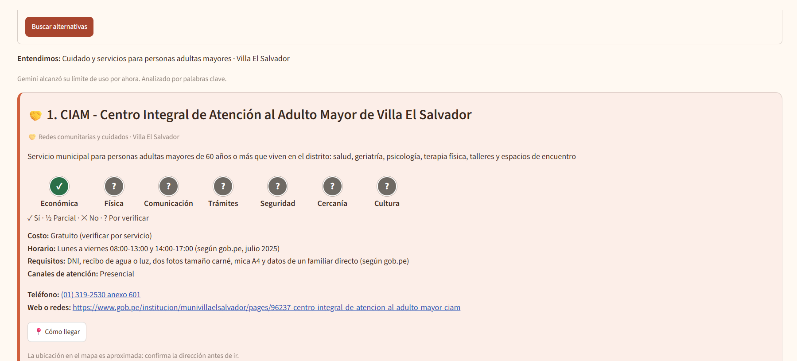
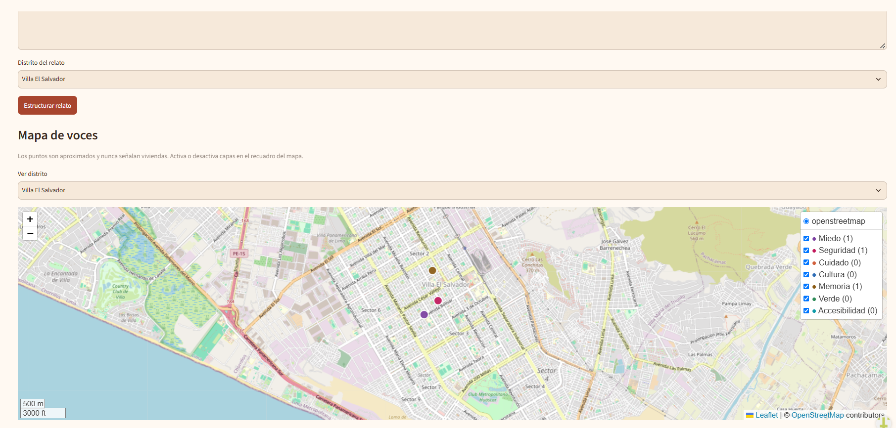
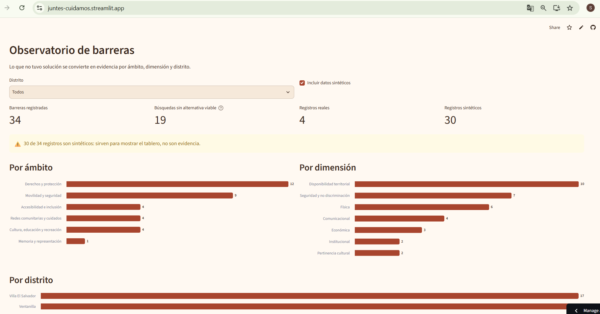
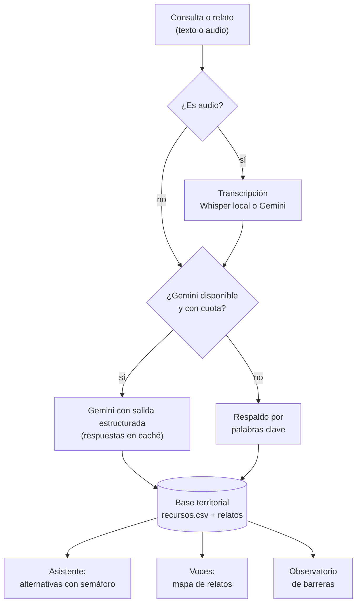

# Juntes nos cuidamos y construimos

**Tecnología para ciudades más justas, accesibles y cuidadoras.**

> Juntes escucha las voces del barrio, conecta a las personas con servicios y redes que realmente pueden usar, y convierte cada barrera en evidencia para construir ciudades cuidadoras.

**Demo:** https://juntes-cuidamos.streamlit.app  
**Video de respaldo:** https://drive.google.com/file/d/1MgkgzCQPuX2LosaALb7C1wDlrMrqOQb9/view?usp=sharing

---

## 1. One-liner

Conectamos a vecinas, jóvenes y personas mayores con rutas reales de acceso a derechos, servicios, cultura y redes de apoyo, mediante un asistente que evalúa siete dimensiones de accesibilidad y un mapa construido con las voces del barrio.

## 2. Founder

**Sandy Patricia Martínez Jara** — socióloga, docente e investigadora


> Más de 14 años conectando políticas públicas, territorio y evidencia para que los derechos lleguen a las personas en su diversidad.

**Por qué soy la persona indicada.** He trabajado en el Estado, la sociedad civil y la cooperación internacional en América Latina, diseñando y fortaleciendo políticas e intervenciones, generando evidencia y articulando gobiernos, instituciones y organizaciones comunitarias, desde una perspectiva de género, interseccionalidad, derechos humanos y diversidad. Conozco desde adentro cómo se formulan los planes que Juntes alimenta y cómo se viven las barreras en los barrios. Hoy sumo la ciencia de datos para transformar información en evidencia útil y visibilizar desigualdades.

**Capacidades que traigo**

- **Estado y políticas públicas:** diseño, implementación y evaluación.
- **Derechos humanos y diversidad:** género e interseccionalidad.
- **Territorio y articulación:** gobiernos, instituciones y organizaciones comunitarias.
- **Conocimiento y formación:** investigación aplicada, gestión del conocimiento y desarrollo de capacidades.
- **Ciencia de datos:** transformación de información en evidencia para la acción.

**Cómo cubro cada rol con agentes de IA**

| Rol | Cómo lo cubro |
| --- | --- |
| Producto | Mi experiencia en políticas públicas y territorio, y las conversaciones con usuarias |
| Ingeniería | Claude Code como co-founder técnico; yo defino la lógica de las siete dimensiones y reviso cada parte del código |
| Diseño | Iteración rápida con Claude Code y pruebas con personas usuarias |
| Ventas | Mi red en gobiernos locales, sociedad civil y consultoría social |

*Juntes es mi apuesta por conectar conocimiento, tecnología y acción para construir ciudades más justas, accesibles y cuidadoras.*

## 3. Problema

**Quién lo sufre.** Mujeres, niñas, jóvenes, personas mayores, personas con discapacidad, migrantes y personas LGTBIQ+ de barrios populares de Lima que necesitan acceder a servicios de protección, salud, cultura o cuidado. Y los equipos municipales que deben diagnosticar esas barreras para sus planes.

**El problema.** No basta con que un servicio exista. Muchas veces falla en una condición concreta: cuesta, queda lejos, no tiene rampa, pide un requisito imposible, no atiende en quechua o el camino es inseguro de noche. Nadie mide cuál de esas condiciones falla.

**Cómo se resuelve hoy.** Directorios en PDF desactualizados, preguntar por WhatsApp a conocidas, talleres participativos en papelógrafos que nadie sistematiza, diagnósticos que tardan meses.

**Cuánto cuesta.** Tiempo perdido buscando en sitios oficiales incompletos o desactualizados, derivaciones a líneas con listas de espera y, muchas veces, el abandono de la búsqueda: el derecho existe, pero no se ejerce.

**Evidencia.** Notas de 3 conversaciones con usuarias potenciales en [`docs/research/`](docs/research/):

1. Profesional con experiencia de trabajo en Villa El Salvador: "Al tener conocimiento de los derechos y los servicios disponibles de manera clara puede abrir un gran abanico de oportunidades". [Entrevista 1](docs/research/entrevista_01.md)
2. Profesional tester en Argentina: "no sabía a dónde acudir". [Entrevista 2](docs/research/entrevista_02.md)
3. [Tres pruebas de la app publicada](docs/research/pruebas_usuarias.md) con una especialista en género y gestión pública con experiencia en Villa El Salvador y Ventanilla; una gestora cultural, madre, que la evaluó desde los servicios para infancias; y un sociólogo con perspectiva de género que ha trabajado en Lima y Buenos Aires. Las tres personas entendieron el propósito. Las sugerencias de las dos primeras se implementaron el mismo día, y la tercera señaló la brecha digital como barrera, incluso para usar Juntes.

## 4. Solución e insight

**Qué construí.** Una plataforma con dos puertas de entrada y una base territorial común:

- **Asistente de rutas:** la persona cuenta su necesidad y recibe dos o tres alternativas viables, con un semáforo de siete dimensiones de accesibilidad y la explicación de cada barrera.
- **Voces que conectan y construyen:** relatos escritos o grabados sobre el barrio, en las capas miedo, seguridad, cuidado, cultura, memoria, verde y accesibilidad, que se convierten en un mapa con capas. Próximo paso: una ruta sonora con la historia de las mujeres del barrio.
- **Observatorio de barreras:** junta lo que no tuvo solución y lo convierte en evidencia por zona, ámbito y dimensión.

**Las siete dimensiones de accesibilidad**

| Dimensión | Pregunta |
| --- | --- |
| Económica | ¿Puede pagar el servicio y llegar hasta él? |
| Física | ¿Puede ingresar y desplazarse en el espacio? |
| Comunicacional | ¿Puede comprender y utilizar la información? |
| Institucional | ¿Conoce los requisitos y puede completar el procedimiento? |
| Seguridad y no discriminación | ¿Puede acceder sin exponerse a violencia o trato discriminatorio? |
| Disponibilidad territorial | ¿Hay una alternativa razonablemente próxima y operativa? |
| Pertinencia cultural | ¿La atención considera idioma, contexto y particularidades culturales? |

**Cinco ámbitos + memoria:** acceso a derechos y protección · movilidad y seguridad · accesibilidad e inclusión · cultura, educación y recreación · redes comunitarias y cuidados · memoria y representación (transversal).

**El insight.** Una barrera es un desajuste entre lo que una persona necesita y las condiciones reales de su entorno. Los servicios existen pero no llegan, y la memoria de quienes sostienen el barrio no aparece en ningún mapa. Inspirada en el urbanismo feminista del Col·lectiu Punt 6, Juntes lleva la auditoría de la ciudad cuidadora a escala: con voz, de forma continua y con una alternativa para cada persona.

## 5. Why now

Hace tres años, transcribir y codificar cientos de relatos costaba meses. Hoy Whisper puede transcribir el audio en local, sin que la grabación salga de la computadora, y un LLM estructura cada relato o consulta en segundos y por centavos. Cuando hay clave de API, el texto de consultas y relatos se envía al proveedor de IA configurado (hoy Google Gemini); sin clave, ese texto no sale de la computadora.

## 6. Demo

**URL:** https://juntes-cuidamos.streamlit.app  
**Video de respaldo:** https://drive.google.com/file/d/1MgkgzCQPuX2LosaALb7C1wDlrMrqOQb9/view?usp=sharing

**Cómo correrlo en local**

Después de crear el archivo `.env` con `copy`, agrega tu clave de API en ese archivo antes de ejecutar `streamlit run`.

```bash
git clone https://github.com/sandypmj/juntes.git
cd juntes
pip install -r requirements.txt
copy .env.example .env
streamlit run app/app.py
```

**Capturas del flujo principal** (versión publicada):

**1. Asistente.** Ante "cuidado para mi mamá adulta mayor" en Villa El Salvador, la primera alternativa es el CIAM del distrito. La tarjeta muestra el semáforo de las siete dimensiones, el costo, el horario, los requisitos, el teléfono, la web oficial y el botón "Cómo llegar". En la captura, Gemini había alcanzado su límite de uso y la app siguió funcionando con palabras clave.



**2. Voces.** El mapa de relatos de Villa El Salvador tiene capas de miedo, seguridad, cuidado, cultura, memoria, verde y accesibilidad. Los puntos son aproximados y nunca señalan viviendas.



**3. Observatorio.** Las barreras sin solución se agrupan por ámbito, dimensión y distrito. El tablero separa los registros reales de los sintéticos y avisa que los sintéticos no son evidencia.



**Arquitectura**



**Modelos y APIs, y por qué**

- **Whisper (modelo "base") en local:** cuando la app corre en una computadora con `faster-whisper` instalado, el audio, grabado con el micrófono o subido como archivo, se transcribe ahí mismo y no sale del equipo. En la versión publicada, Whisper no está instalado para que la app siga liviana, y el audio se transcribe con Google Gemini. Por eso el demo público usa solo datos sintéticos. Sin Whisper ni Gemini, la persona pega el texto. La app siempre muestra qué método usó.
- **LLM con salidas estructuradas:** clasifica relatos y consultas en ámbito, dimensión, lugar y barrera con un esquema fijo, para poder agregarlos. Cuando hay clave de API, el texto de consultas y relatos se envía al proveedor de IA configurado (hoy Google Gemini); sin clave, la app usa un respaldo por palabras clave y ese texto no sale de la computadora. Las respuestas se guardan en caché en la memoria del servidor por 7 días, así una consulta o un relato repetido no gasta cuota de nuevo.
- **Orden de las alternativas:** primero la pertinencia (que el recurso responda a la necesidad), después los recursos reales antes que los ejemplos sintéticos, y recién después el semáforo. Un dato "por verificar" no hunde a un recurso pertinente.
- **Folium:** mapa con capas, liviano y sin costo.
- **Texto a voz (próximo paso, aún no implementado):** una ruta sonora con voz sintética, para quien prefiera no ser reconocida.

## 7. Modelo de negocio

Gratis para la comunidad. Pagan quienes obtienen valor institucional. La cooperación es un complemento, nunca la base.

| Plan | Para quién | Qué recibe | Precio (hipótesis) |
| --- | --- | --- | --- |
| Comunidad | Personas, ollas comunes, colectivos | Asistente, mapa, relatos y, como próximo paso, rutas sonoras | Gratis |
| Organizaciones | ONG, colegios, centros culturales, universidades | Panel de su territorio, reportes y, como próximo paso, ruta sonora a medida | S/ 100 al mes (próximo paso: S/ 1,500 por ruta sonora) |
| Institucional | Consultoras, empresas, inmobiliarias, municipalidades | Diagnóstico participativo con enfoque de género, observatorio, informe anexable | Desde S/ 12,000 por proyecto |

**Fuentes de ingreso, de mayor a menor peso:** consultoras y empresas (líneas base sociales y participación ciudadana) · organizaciones · pilotos municipales · cooperación y fondos concursables como complemento (máximo un tercio del ingreso).

**Costo por usuario.** El costo principal es la facilitación en campo, no la tecnología.

- **Hoy:** el demo usa el nivel gratuito de Gemini, con costo cero. Ese nivel tiene un límite de solicitudes por día, que se alcanzó durante las pruebas. Dos cosas lo mitigan: la caché, que evita repetir llamadas para textos iguales, y el respaldo por palabras clave, que mantiene la app funcionando cuando se acaba la cuota. Streamlit Community Cloud también es gratuito.
- **En el nivel de pago:** `gemini-3.5-flash` hoy redirige a Gemini 3.6 Flash. Su precio de lista es USD 1,50 por millón de tokens de entrada y USD 7,50 por millón de salida, y hasta el 31 de diciembre de 2026 cuesta la mitad. Medimos los tokens con la función `count_tokens` de Gemini.

| Uso | Entrada (tokens) | Salida (tokens) | Costo aproximado |
| --- | --- | --- | --- |
| Una consulta | ~1.150 (instrucciones 400 + esquema 725 + consulta ~20) | ~100 de respuesta, hasta ~1.000 si el modelo "piensa" | USD 0,003 a 0,009 |
| Un relato escrito | ~700 (instrucciones 85 + esquema 400 + relato de ~150 palabras) | ~350 (incluye el texto anonimizado), hasta ~1.300 | USD 0,004 a 0,011 |
| Un relato de 1 minuto de audio transcrito con Gemini | +~1.900 de audio (32 tokens por segundo) | +~250 de transcripción, hasta ~1.200 | USD 0,008 a 0,023 en total |

| Volumen mensual | Costo aproximado |
| --- | --- |
| 200 relatos con audio | USD 1,70 a 4,50 |
| 1.000 consultas | USD 2,50 a 9,20 |
| **Total** | **USD 4 a 14 al mes (unos S/ 15 a 51, a S/ 3,70 por dólar)** |

El rango depende de cuántos tokens de razonamiento use el modelo, que se cobran como salida. Con Whisper local, la transcripción cuesta cero. Las consultas repetidas no se cobran gracias a la caché. Son estimaciones: el costo real hay que medirlo con el uso.

## 8. Herramientas del curso

| Herramienta | Sesión | Dónde está en el repo |
| --- | --- | --- |
| Whisper (voz a texto) | 13 | `ai/transcribir.py`: Whisper "base" en local; en la versión publicada, Gemini transcribe el audio |
| LLM con salidas estructuradas | 08 | `ai/estructurar.py` |
| Mapas con Folium | 06 | `app/app.py` (pestañas Voces y Observatorio) |
| Dashboard | 05 | `app/app.py` (pestaña Observatorio) |
| Texto a voz (opcional) | 15 | Próximo paso: ruta sonora con voz sintética (aún no implementado) |

## 9. Qué hizo el agente

Construí Juntes entre el 9 y el 10 de noviembre de 2026 con Claude Code como agente de programación. Le di las instrucciones en español, revisé cada resultado y decidí qué subir. Cada paso quedó en el historial de git.

**Qué generó Claude Code**

- **La app** (`app/app.py`): las pestañas Asistente, Voces y Observatorio; el semáforo de siete dimensiones; los mapas con Folium; el tablero del Observatorio; las tarjetas con ícono por ámbito; los datos de contacto con botón "Cómo llegar"; y los botones de búsqueda de ejemplo.
- **La capa de IA** (`ai/estructurar.py`): esquemas Pydantic para la salida estructurada, la conexión con Gemini (y con Claude, como opción) y el respaldo por palabras clave con sinónimos.
- **La transcripción** (`ai/transcribir.py`): grabar desde el micrófono o subir un archivo, y transcribir con Whisper local o con Gemini.
- **Los datos** (`data/`): búsqueda de direcciones, teléfonos y webs en fuentes oficiales (gob.pe). Lo que no se pudo verificar dice "por verificar". También los ejemplos sintéticos, marcados como tales.
- **La documentación:** este README y el registro de las pruebas con usuarias ([`docs/research/pruebas_usuarias.md`](docs/research/pruebas_usuarias.md)), a partir de las respuestas textuales que le pasé.

**Problemas que resolvió**

- **Gemini saturado (error 503).** Varios modelos de Gemini respondían "high demand". Claude Code probó los modelos disponibles y dejó `gemini-3.5-flash`, que sí respondía. Además, cualquier error de la API, como un 503, el límite de cuota o una falla de red, activa el respaldo por palabras clave, y la app avisa qué modo usó.
- **Separación de datos reales y sintéticos.** Los CSV públicos de `data/` traen solo ejemplos sintéticos, marcados en el mapa y en las tarjetas. Lo real se guarda en `data/privado/`, que Git ignora. El Observatorio guarda solo categorías, nunca el texto de la consulta, y separa los registros reales de los sintéticos.
- **Orden de resultados por pertinencia.** Los ejemplos sintéticos, con todas las dimensiones en "sí", aparecían antes que el CIAM real, que estaba "por verificar". Ahora el orden es: pertinencia, después recursos reales antes que sintéticos, y recién después el semáforo.
- **Caché.** El nivel gratuito de Gemini se agotó con las pruebas. Ahora las respuestas exitosas, de texto y de audio, se guardan en caché, y los errores no.
- **Whisper con PyAV compatible.** Con PyAV 19, faster-whisper fallaba al leer el audio. Con PyAV 18.1 (`av<19`), Whisper "base" transcribe en local.
- **Mejoras por las pruebas con usuarias:**
  - Cuna Más, el CIAM, el INABIF y los comedores de personas adultas mayores.
  - Sinónimos como guardería, wawa wasi, anciano o tercera edad.
  - Datos de contacto y el botón "Cómo llegar".
  - Aviso honesto cuando no hay un recurso.
  - Búsquedas de movilidad con relatos de las vecinas y contactos útiles.
  - Un diseño menos plano.

**Qué decidí yo**

- **El marco conceptual:** cinco ámbitos más memoria, y las siete dimensiones de accesibilidad con sus preguntas.
- **El territorio:** Villa El Salvador y Ventanilla como distritos piloto.
- **Los cuidados éticos:**
  - Consentimiento y anonimización.
  - Nunca ubicar viviendas.
  - No pedir relatos de violencia en detalle.
  - Mostrar primero la Línea 100 y el 105.
  - Usar solo datos sintéticos en el demo público.
- **El modelo de negocio:** planes, precios y fuentes de ingreso.
- **La investigación:** a quién entrevistar y quién probaría la app, qué comentarios atender y qué cambiar según ellos. Dejé las fotos de lugares para cuando las organizaciones den permiso.

## Ética y cuidados

- Consentimiento explícito con una casilla antes de guardar cada relato.
- Anonimización de personas vivas; nunca se ubican viviendas.
- No se piden relatos de violencia en detalle.
- Si una consulta sugiere riesgo, la Línea 100 y el 105 aparecen primero.
- El asistente orienta; no reemplaza la atención ni da asesoría legal.
- Cada dato indica si está verificado, reportado por la comunidad o sin verificar.
- Los datos del demo son públicos, propios o sintéticos (marcados como tales).
- Cuando la app corre en una computadora con Whisper, el audio se transcribe en local y no sale del equipo. En la versión publicada, el audio se transcribe con Google Gemini; por eso el demo público usa solo datos sintéticos.
- Cuando hay clave de API, el texto de consultas y relatos se envía al proveedor de IA configurado (hoy Google Gemini); sin clave, ese texto no sale de la computadora.
- En el nivel gratuito de Gemini, el proveedor puede usar los datos para mejorar sus servicios; por eso el demo público usa solo datos sintéticos.
- Los relatos y barreras reales no se suben al repositorio público; solo se publican los ejemplos sintéticos.
- Próximo paso: consentimiento grabado al inicio de cada relato de audio.

## Licencia

MIT
